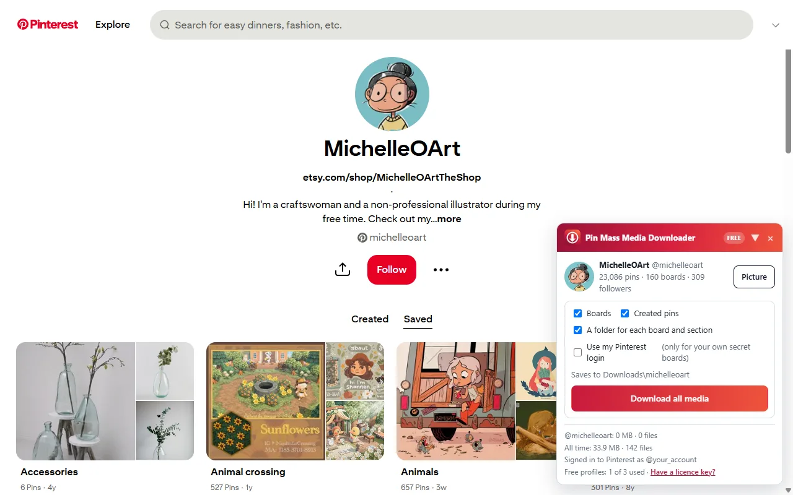
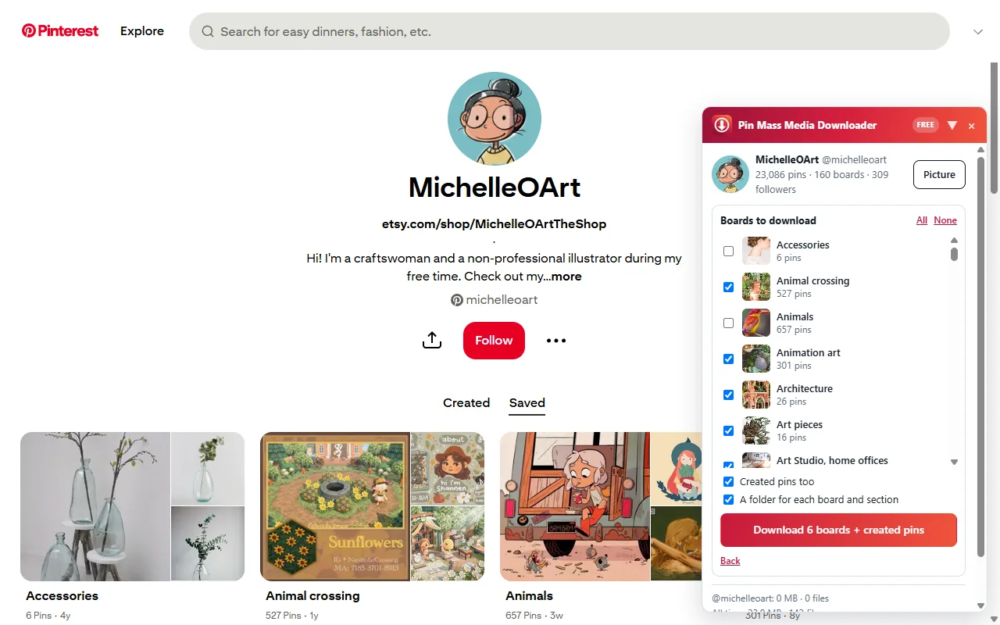
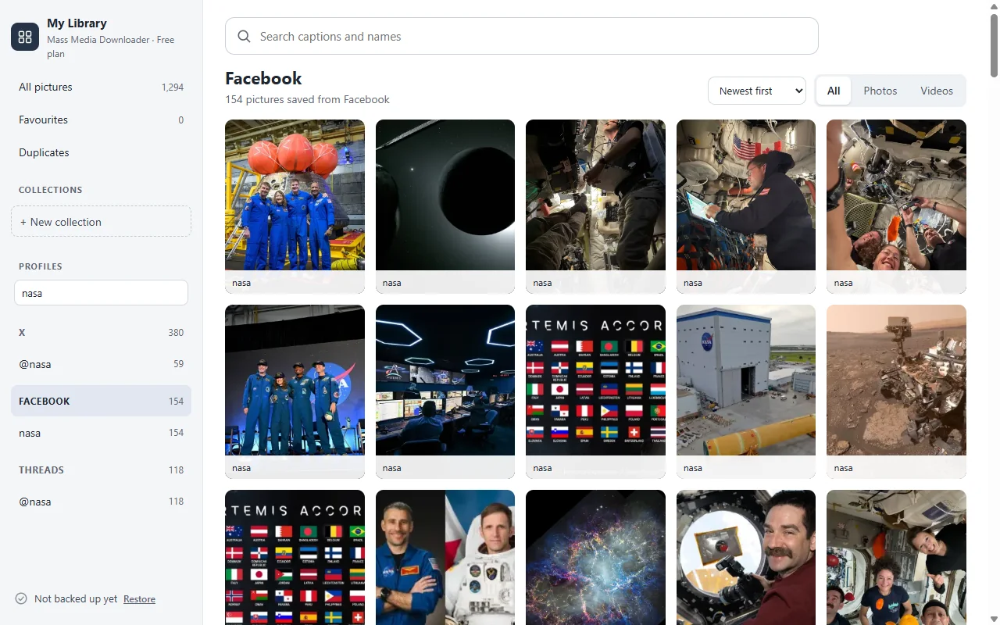

# Mass Media Downloader: Pinterest, Reddit, X and more in one Chrome extension

A browser extension that saves pictures and videos from the sites you use to your computer, in tidy folders, for your own reference library. It covers Pinterest, Reddit, X, Bluesky, Tumblr, Threads, Facebook and VSCO, and it can save a clip or a GIF from a web video. For Chrome, Brave and Edge.

**[Add to Chrome](https://chromewebstore.google.com/detail/ehikbcioolopbfpcckoanobhjaobcdjk)** · [Website](https://novabyteworks.com/pinterest) · [Guides](https://novabyteworks.com/guides) · [Pricing](https://novabyteworks.com/pinterest#pricing) · [Privacy](https://novabyteworks.com/privacy-pinterest)

> **This repository is for bug reports, feature requests and release notes.** The extension is not open source, so its code is not here. Single posts are always free and each site has a free allowance; more than that needs a paid key.

## How it works

1. Open a profile, board or blog on a supported site. A small panel appears on the page.
2. Press the download button.
3. The files arrive in folders inside your Downloads folder. Run it again later and it skips what you already have.

## What it saves

| Site | What you can save |
|---|---|
| **Pinterest** | A whole profile, a board or a section, the pins a profile created, or a single pin. Images and supported videos. It works signed out; your Pinterest login is used only when you choose, for example for your own secret boards. |
| **Reddit** | The media of a subreddit or a user, your saved posts, or a single post. Images, galleries and Reddit video with its sound. |
| **X** | A profile's media, your bookmarks, or a single post. Original-size photos and the MP4 videos X makes available to your signed-in page. Likes are not included. |
| **Bluesky** | A profile's media, your likes, or a single post. |
| **Tumblr** | A whole blog, your likes, or a single post. Original images, GIFs and Tumblr-hosted video when available. Video and audio embedded from other sites are skipped. |
| **Threads** | A profile or a single post. Photos, carousels and videos. |
| **Facebook** | The Photos uploads of a page or profile, or a single photo, at the largest size served. Videos, albums and groups are not supported. |
| **VSCO** | A profile's media or a single post, with an option to include reposts. |

Instagram and TikTok have extensions of their own, listed at the end.

## Clip & GIF

On supported video pages, pick a short section and save it as a clip or a GIF, or save one frame as a picture. Open it from the toolbar, or by right-clicking the page or the video. YouTube, copy-protected video and restricted browser pages are not supported, and not every player or video format can be captured.

## My Library

Browse what you saved in one gallery on your own computer, with collections, search, filters, favourites and tags. To see the pictures themselves, choose the folder they were saved in. Smart search is optional: it downloads its model once and then runs on your computer. The gallery never uploads your folder and never changes your files.

## Free and paid

- Single posts, photos and pins are always free.
- Whole profiles, blogs and boards: each site has a free allowance, normally three for each signed-in account. The panel shows what applies.
- On Bluesky and Tumblr, your 20 most recent likes are free.
- Clips and GIFs are free up to 10 seconds, and saving a frame is free. With a paid key, clips can be up to 5 minutes and GIFs up to 30 seconds.
- One plan, **All sites**, covers every site in this extension, as a monthly subscription or a one-time lifetime purchase. See [pricing](https://novabyteworks.com/pinterest#pricing).

## Good to know

Keep the site's tab open while it saves. You can stop a run, look at the result and run it again. Changes on a site, missing originals, login and access rules, rate limits and other download managers can all affect the result. This extension does not bypass access controls or copy protection.

## Help

- Pinterest: [download a board](https://novabyteworks.com/download-pinterest-board), [back up your boards](https://novabyteworks.com/backup-pinterest-boards)
- Reddit: [your saved posts](https://novabyteworks.com/download-reddit-saved-posts), [the images of a subreddit](https://novabyteworks.com/download-subreddit-images)
- X: [a profile's media](https://novabyteworks.com/download-twitter-media), [your bookmarks](https://novabyteworks.com/download-twitter-bookmarks)
- [Tumblr](https://novabyteworks.com/download-tumblr-blog), [Bluesky](https://novabyteworks.com/download-bluesky-media), [Threads](https://novabyteworks.com/download-threads-media), [VSCO](https://novabyteworks.com/download-vsco-profile), [Facebook](https://novabyteworks.com/download-facebook-page-photos), [video to GIF](https://novabyteworks.com/video-to-gif-chrome-extension)
- [All guides](https://novabyteworks.com/guides)

## Report a bug or ask for a feature

[Open an issue](https://github.com/novabyteworks/mass-media-downloader/issues/new/choose). Please say which site you were on, which version you have (it is shown on `chrome://extensions`) and what the panel showed.

For licence keys and payments, write to support@novabyteworks.com instead. Never post a licence key here.

## Release notes

See [CHANGELOG.md](CHANGELOG.md). Updates arrive by themselves through the Chrome Web Store.

## Our other extensions

- [IG Mass Media Downloader](https://github.com/novabyteworks/instagram-downloader): every post, reel, story and highlight of an Instagram profile
- [TT Mass Media Downloader](https://github.com/novabyteworks/tiktok-downloader): every video and photo post of a TikTok profile, without the watermark

---

Mass Media Downloader is made by [NovaByteWorks](https://novabyteworks.com). It is not affiliated with, endorsed by, or connected to Pinterest, Inc. or any of the sites it supports. Please respect creators' rights and use saved media for your own lawful reference.
